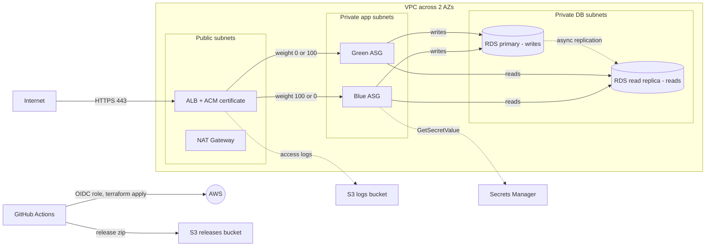

# AWS Infrastructure + Blue/Green CI/CD (Terraform modules, GitHub Actions)

Node.js (Express) app on an EC2 Auto Scaling Group behind an HTTPS Application Load Balancer, backed by an RDS MySQL **primary (writes) and read replica (reads)**.
Infrastructure is split into reusable Terraform modules with separate `dev` and `prod` environments. Releases ship with a **blue/green** strategy from GitHub Actions.

**Step-by-step setup: [docs/DEPLOYMENT.md](docs/DEPLOYMENT.md)**

## Architecture



## Terraform structure

```
terraform/
  modules/                 reusable building blocks
    network/               VPC, public/private/db subnets, IGW, NAT, route tables
    security/              security groups (ALB -> app -> DB chain)
    storage/               app bucket + ALB access-log bucket
    database/              RDS primary, read replica, parameter group, Secrets Manager
    iam/                   EC2 role (least privilege) and instance profile
    alb/                   ALB, ACM certificate, Route53, per-colour target groups, weighted listener
    compute/               launch templates + blue/green Auto Scaling Groups
    monitoring/            SNS topic and CloudWatch alarms
  envs/
    dev/                   root module: wires the modules, terraform.tfvars with dev sizing
    prod/                  same wiring, prod sizing (Multi-AZ DB, NAT per AZ, deletion protection)
bootstrap/                 one-time: state bucket, releases bucket, GitHub OIDC role
```

Each environment has its own state file (`dev/terraform.tfstate`, `prod/terraform.tfstate`) in the same S3 bucket.

## Database: primary + read replica

- The app opens two connection pools. **Writes** go to the primary, **reads** go to the replica (`GET /api/notes` is served from the reader).
- Credentials, the writer host and the reader host all live in one Secrets Manager secret.
- `GET /db/status` shows both hosts; the replica reports `read_only = 1`. `GET /health/db` checks that both answer.
- TLS is required by a parameter group (`require_secure_transport`), storage is encrypted, and the DB is only reachable from the app security group.
- Replication is asynchronous, so a read right after a write can lag by a moment (alarm at 60 s of lag).

### Free tier reality

- The free tier gives 750 hours per month of **Single-AZ** `db.t3.micro` and 20 GB of storage, shared by *all* RDS instances in the account. A replica is a second instance, so running both 24/7 uses the 750 hours in about 15 days; the replica is billed at the normal rate (roughly 0.016 USD per hour for a `db.t3.micro`).
- Multi-AZ is not free tier, so `dev` is Single-AZ and `prod` is not intended to be free.
- Free tier accounts limit backup retention (keep `db_backup_retention_days = 1`), and a read replica needs automated backups on, so retention cannot be 0.
- Storage autoscaling is off in dev to avoid leaving the 20 GB limit.
- To stay fully free, set `db_create_read_replica = false` in `terraform/envs/dev/terraform.tfvars`. The app still works: reader and writer then point at the same instance.
- The NAT gateway and ALB are **not** free. Deploy, take screenshots, then run the `destroy` action.

## How blue/green works

Two identical stacks, **blue** and **green**, each with its own ASG and target group. The HTTPS listener sends 100% of traffic to the *active* colour and 0% to the other.

On every push to `main` (dev environment) the pipeline:

1. Uploads the new release zip to S3.
2. Deploys it to the idle colour at full size. Terraform waits until every instance is healthy. Users still hit the old colour.
3. Switches the listener weights so the new colour gets 100% of traffic.
4. Smoke-tests `/health/db` and checks `/version` shows the new release. **If it fails, traffic switches back automatically.**
5. Keeps the old colour warm so rollback is instant.

Manual controls: Actions → *Deploy (Blue/Green)* → Run workflow → choose `deploy`, `rollback` or `destroy` and the environment (`dev` or `prod`).

## Repo layout

| Path | Purpose |
|---|---|
| `app/` | Express + MySQL app (`/health`, `/health/db`, `/db/status`, `/version`, `/api/notes`, `/api/upload`) |
| `bootstrap/` | One-time Terraform: state bucket, releases bucket, GitHub OIDC provider and IAM role |
| `terraform/` | Modules and environments (above) |
| `scripts/deploy.sh` | Blue/green logic (plan, deploy, rollback, destroy) |
| `.github/workflows/deploy.yml` | CI/CD pipeline |
| `docker-compose.yml` | Local MySQL for testing |

## Security

- App and DB in private subnets; DB subnets have no internet route
- Security groups chained: internet to ALB (443) to app to DB (3306); no SSH, access via SSM Session Manager
- RDS, EBS and S3 encrypted at rest; S3 public access blocked and TLS-only bucket policies
- DB password generated by Terraform, stored in Secrets Manager, read at runtime through the instance role
- Least-privilege instance role (one secret, release prefix read, uploads prefix write)
- IMDSv2 enforced; TLS 1.3 policy on ALB; HTTP redirects to HTTPS
- GitHub authenticates to AWS with OIDC, no long-lived keys
- Terraform state in an encrypted, versioned S3 bucket with native locking

## Known trade-offs (mention them in an interview)

- `dev` uses one shared NAT gateway and a Single-AZ primary to keep cost low; `prod` sets one NAT per AZ and Multi-AZ.
- The GitHub role has `AdministratorAccess` for simplicity; production would use a scoped policy.
- `rejectUnauthorized: false` encrypts the DB connection but does not verify the certificate; production would load the RDS CA bundle.
- State contains the generated DB password, so the state bucket must stay private.
- Not included, but the next steps for production: WAF on the ALB, VPC flow logs, a separate AWS account per environment, RDS Proxy.

## Run the app locally

```powershell
docker compose up -d      # MySQL on localhost:3307
cd app
npm install
npm start                 # http://localhost:3000
```
Locally the reader and writer both use the same MySQL container.
